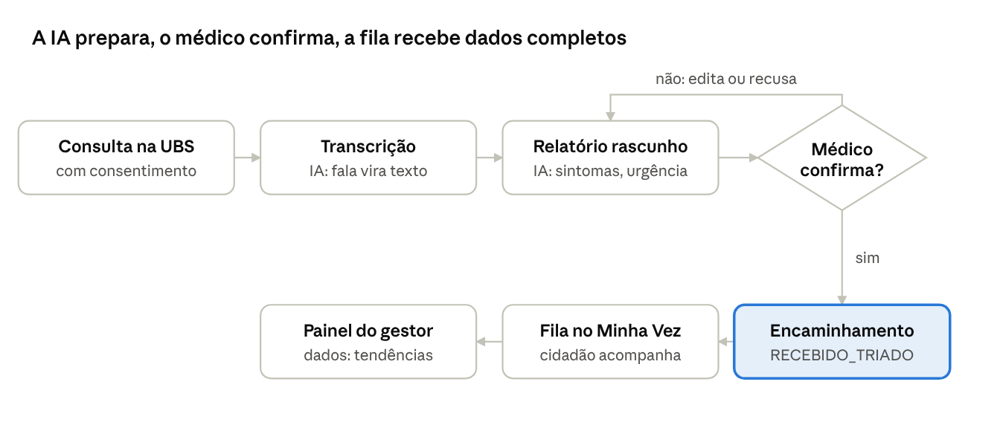

# Minha Vez — Proposta de IA e Ciência de Dados

Enterprise Challenge 2SIOR · Atividade 1 · 04/11/2026

A proposta do Grupo 1 coloca no Minha Vez uma IA que escuta a consulta na UBS e entrega ao médico um relatório e um rascunho do encaminhamento. Quem decide continua sendo o médico. Os dados desses encaminhamentos alimentam o painel do gestor com tendências da fila.

## Grupo

| Integrante | RM |
| --- | --- |
| Vinícius Cardoso Junqueira | 566906 |
| Ana Larissa Cristo Mendes | 567403 |
| João Pedro Thethê Andrade | 568305 |
| John Vitor Silverio Pereira | 566968 |
| Brenda Cristina Martins Araújo | 575032 |

Vídeo pitch (YouTube, não listado): link a preencher depois da gravação. O mesmo link vai no arquivo .txt e nos slides.

## O problema público

O encaminhamento do cidadão da UBS para a atenção especializada não pode ser rastreado. Hoje ele vira papel, ligação ou sistema paralelo, e o paciente some da vista do cidadão e do gestor.

O gargalo não é só a falta de especialistas. Falta um fluxo de referência com dados padronizados. Uma auditoria do TCU apontou a falta de alimentação padronizada de dados no sistema do Ministério da Saúde como gargalo de visibilidade.

Resolver importa porque a espera custa saúde. Pesquisa do Instituto Locomotiva: 94% dos brasileiros da Classe C acham que a espera no SUS coloca vidas em risco, e cerca de 1 em cada 3 já desistiu de uma consulta demorada. Quem mais perde é quem tem menos tempo e mobilidade: idosos e trabalhadores informais.

Fontes: as mesmas citadas na documentação da Fase 1 do projeto.

## O projeto: Minha Vez

O Minha Vez é um sistema de gestão pública para acompanhar o encaminhamento da UBS até a consulta especializada. Ele tem três canais: app e totem do cidadão, painel da sala de espera e painel web da equipe e do gestor.

| História | O que o cidadão ou a equipe faz |
| --- | --- |
| US01 Identificação | entra por Cartão SUS ou CPF no totem, ou CPF + senha ou Gov.br no app |
| US02 Acompanhamento | vê a etapa do pedido: recebido e triado, aguardando agendamento, concluído |
| US03 Agendamento | escolhe um horário livre na unidade de destino, com reagendamento e cancelamento |
| US04 Chamada | vê a senha e a sala no painel, sem nome nem dado clínico |
| US05 Painel gerencial | equipe e gestor veem a fila por especialidade, ações pendentes, espera média e faltas |

Até a Fase 3 o projeto tem: domínio em Java com 9 classes e 4 enumerações, 5 testes automatizados passando, modelo de dados normalizado até a BCNF com 12 tabelas, diagramas UML e wireframes no Figma.

Uma regra guia tudo: dado clínico e nome completo só aparecem no canal institucional, nunca nas telas públicas (RNF01). Hoje o Minha Vez não guarda CID, laudo nem prontuário.

## 1. Que problema a IA e a ciência de dados resolvem

A IA ataca a origem da fila: o momento da consulta na UBS em que o encaminhamento nasce. A ciência de dados ataca o fim: a fila vista pelo gestor.

**Na consulta.** Um médico da atenção primária atende dezenas de pacientes em poucas horas. A consulta vira repetição, e detalhes que mudam a conduta podem passar despercebidos. Isso pesa mais na primeira consulta, quando o médico ainda não conhece o paciente. Esta é uma hipótese do grupo, a confirmar com profissionais da UBS e com uma fonte.

**No encaminhamento.** É nessa consulta que se definem a especialidade, a urgência e a justificativa do encaminhamento. Um encaminhamento incompleto ou sem justificativa clara volta, atrasa ou fica com a prioridade errada. O paciente espera mais, e a fila do Minha Vez fica mais longa.

**Na gestão.** O painel da US05 mostra a fila de hoje, mas não antecipa a de amanhã. Com encaminhamentos estruturados desde a origem, o gestor passa a ver tendências: qual especialidade está crescendo e onde as faltas se concentram.

## 2. Que ferramenta usar e como ela entra no Minha Vez

A solução é um assistente de documentação clínica com três peças. Ela não é um chatbot: quem a usa é o médico, dentro do canal institucional.

A IA atua só até o rascunho. O encaminhamento existe a partir da confirmação do médico, e daí segue o fluxo que o Minha Vez já tem.

| Peça | Tecnologia | O que entrega | Onde entra no Minha Vez |
| --- | --- | --- | --- |
| Transcrição | reconhecimento de fala | o texto da conversa entre médico e paciente | só no consultório, com consentimento do paciente |
| Relatório | modelo de linguagem com extração estruturada | sintomas listados, hábitos, medicamentos em uso, pontos de atenção; cada item ligado ao trecho da fala | tela do médico, no canal institucional |
| Rascunho do encaminhamento | o mesmo modelo, sobre o relatório revisado | especialidade sugerida, sinais de urgência, justificativa escrita | vira o `Encaminhamento` em `RECEBIDO_TRIADO` só depois que o médico confirma |
| Análise da fila | ciência de dados sobre encaminhamentos anonimizados | demanda por especialidade, previsão da fila, padrões de falta | painel do gestor (US05) |

**Histórico do paciente.** Em um retorno, o médico abre os relatórios anteriores já revisados, sem procurar em papel. Esse histórico é dado clínico. Por isso ele fica só no canal institucional e nunca aparece no app, no totem ou no painel da sala de espera (RNF01).

**Por que essa escolha.** A IA entra no ponto em que o erro custa mais caro: um encaminhamento mal feito gera semanas de espera inútil. Ela usa o que já existe no domínio (especialidade, selo de urgência, histórico de status) e não cria um sistema paralelo, que é o problema que o projeto critica.

## 3. Benefícios e desafios

O maior ganho é um encaminhamento certo já na primeira vez. O maior risco é o médico confiar na IA sem ler.

### Benefícios

| Para quem | Benefício |
| --- | --- |
| Médico | olha para o paciente em vez de digitar; recebe os detalhes organizados e o histórico em mãos |
| Cidadão | encaminhamento com justificativa completa, prioridade justa e menos idas e voltas |
| Equipe da UBS | menos encaminhamentos devolvidos e menos retrabalho na triagem |
| Gestor | dados padronizados desde a origem; tendências de demanda e de faltas para planejar vagas |
| Todos | o primeiro e o último paciente do turno recebem o mesmo cuidado no registro |

### Desafios e como tratar cada um

| Desafio | Como o projeto trata |
| --- | --- |
| Privacidade: dado de saúde é dado sensível na LGPD | consentimento do paciente antes de gravar; áudio apagado após a transcrição; relatório só no canal institucional (RNF01) |
| Erro de transcrição ou sintoma inventado pela IA | cada item do relatório aponta para o trecho da fala que o gerou; o médico corrige antes de salvar |
| Confiança excessiva: assinar sem ler | relatório marcado como rascunho; nada vai para o encaminhamento sem confirmação explícita |
| Ruído, sotaques e termos regionais | piloto em uma UBS para medir a qualidade antes de ampliar |
| Infraestrutura das UBS: internet, microfone, computador | levantar o que cada unidade tem; a consulta segue normal se a IA falhar |
| Integração com o prontuário que a UBS já usa | integrar em vez de duplicar, para não criar mais um sistema paralelo |
| Adesão dos profissionais e custo de operação | começar pela primeira consulta, onde o ganho é maior, e medir o tempo economizado |

## A IA não decide

A IA não diagnostica, não receita e não encaminha. Ela organiza a informação, e o médico decide e responde pela decisão. No sistema, isso vira regra:

1. Tudo o que a IA produz entra como rascunho, com a marca "gerado por IA, revisar".
2. Nenhum encaminhamento é criado sem a confirmação do médico.
3. O médico pode editar ou apagar qualquer item e recusar a sugestão inteira.
4. O `HistoricoStatus` registra quem confirmou e quando, como já faz com toda mudança de etapa.
5. A consulta funciona igual sem a IA: se ela falhar, o médico registra como sempre.

## Pontos em aberto

Três pontos precisam de decisão do grupo antes da gravação. Depois de decididos, vão para `docs/decisoes.md`.

- [ ] Achar uma fonte para "o médico perde detalhes em consultas seguidas", ou apresentar como hipótese do grupo.
- [ ] Definir onde fica o histórico clínico: um módulo novo do canal institucional ou uma integração com o prontuário da UBS. Hoje o Minha Vez não guarda dado clínico.
- [ ] Incluir o link do vídeo nesta doc, nos slides e no arquivo .txt do ZIP.
