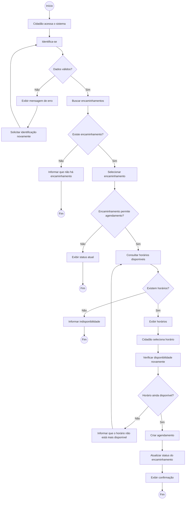
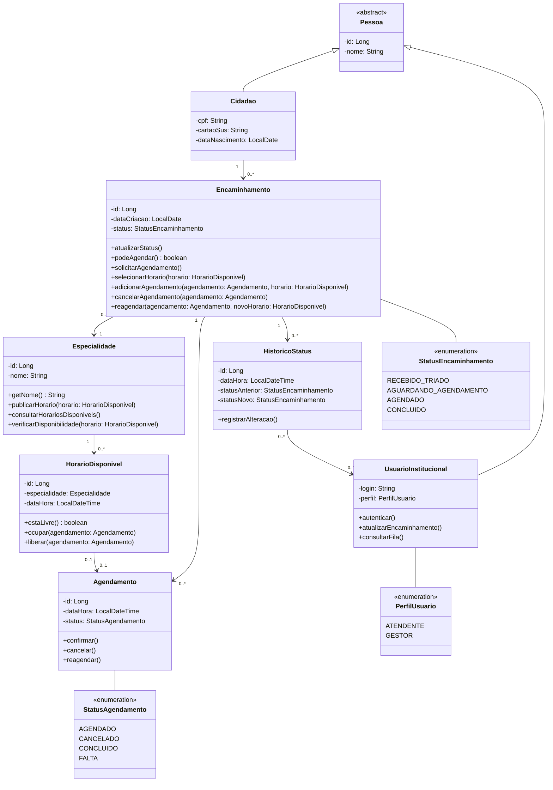
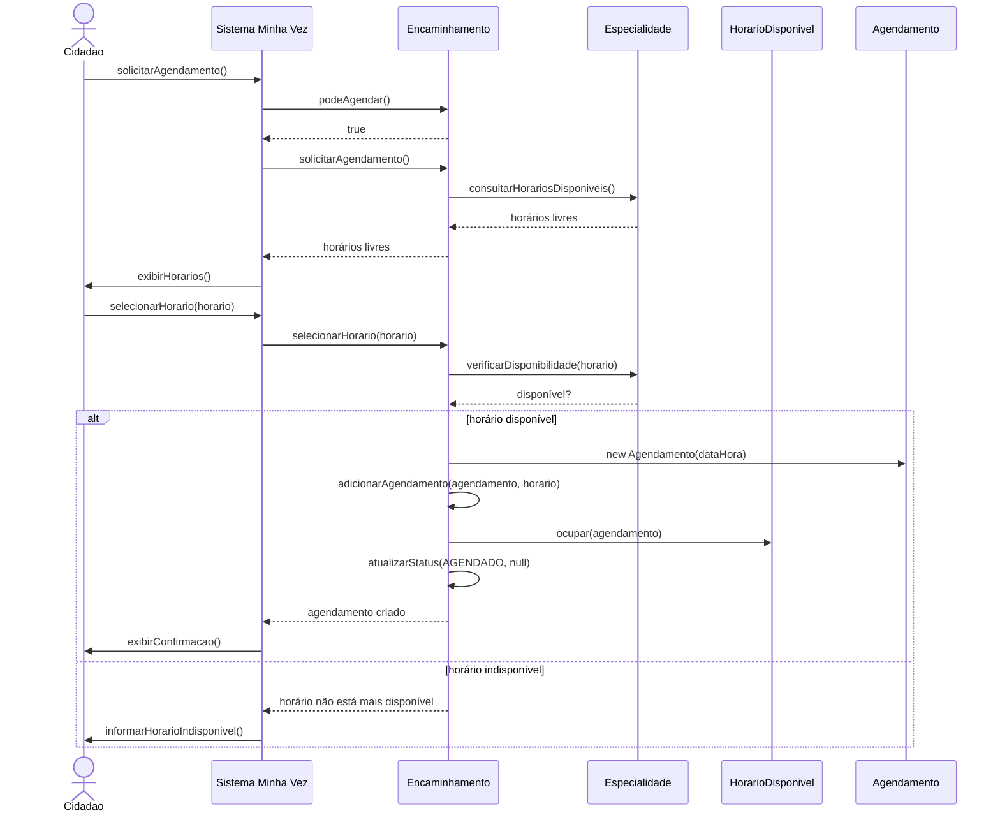

# Parte 2 — Modelagem do sistema com UML e início da implementação em Java

Este documento é a versão corrigida do conteúdo da Parte 2, depois da conferência entre o PDF rascunho e o
código em `src/backend/src/main/java/com/hackgov/backend/domain/`. O Diagrama de Classes já batia com o
código e está reproduzido aqui como veio. O Diagrama de Sequência foi redesenhado porque a colaboração entre
objetos não correspondia ao código; a reflexão técnica teve a citação de User Story ajustada. Casos de Uso e
Atividades seguem como no PDF, porque já conferiam.

## 2.1 Diagrama de Casos de Uso — atores e interações principais com o HackGov

Elaborado a partir das User Stories US01 a US05 (`docs/fase-2-parte-1-backlog-e-sprint-1.md`), que já
descrevem os principais usuários do sistema, seus objetivos e as funcionalidades esperadas. Os três atores
principais — Cidadão, Equipe da UBS e Gestor da UBS — cobrem identificação, acompanhamento do
encaminhamento, agendamento, chamada na sala de espera, gerenciamento da fila e visualização de
indicadores.

```
CIDADÃO
├── Identificar-se
├── Acompanhar status do encaminhamento
├── Agendar horário
│   └── <<include>> Consultar horários disponíveis
├── Reagendar agendamento
│   └── <<include>> Consultar horários disponíveis
├── Cancelar agendamento
└── Visualizar chamada na sala de espera

EQUIPE DA UBS
├── Autenticar-se no painel institucional
├── Atualizar status do encaminhamento
├── Gerenciar fila de encaminhamentos
└── Chamar paciente

GESTOR DA UBS
├── Autenticar-se no painel institucional
├── Gerenciar fila de encaminhamentos
└── Visualizar indicadores
```

Nem toda funcionalidade listada aqui tem classe Java correspondente ainda: identificação (RF01),
indicadores da equipe e a chamada/falta de paciente ficam fora do recorte desta fase — a decisão está
registrada em `handoff.md`, seção 1. O recorte implementado é o de agendamento (US01–US03), descrito na
seção 2.3.

## 2.2 Diagrama de Atividades — fluxo de agendamento de horário

Elaborado a partir da US03 — Agendamento de horário, usando também elementos da US01 — Identificação e da
US02 — Acompanhamento do status, porque essas funcionalidades fazem parte do processo modelado.



A checagem dupla de disponibilidade — uma vez ao consultar horários, outra ao confirmar a escolha — não é
redundância de desenho: é o mesmo par que o código aplica em `Encaminhamento.solicitarAgendamento()` (lista
horários livres) e `Encaminhamento.selecionarHorario()` (revalida com
`Especialidade.verificarDisponibilidade()` antes de criar o `Agendamento`), porque entre a consulta e a
confirmação outra pessoa pode ocupar a vaga.

## 2.3 Diagrama de Classes — estrutura do domínio

Desenvolvido a partir das User Stories e das regras do sistema. A classe abstrata `Pessoa` concentra os
atributos comuns `id` e `nome`, especializada por herança em `Cidadao` e `UsuarioInstitucional`. A
responsabilidade pelo processo de agendamento fica concentrada em `Encaminhamento`; `Especialidade` mantém e
consulta os horários disponíveis por meio de `HorarioDisponivel`. Enumeradores padronizam os estados de
encaminhamento, de agendamento e o perfil de usuário institucional. `HistoricoStatus` registra as alterações
de status do encaminhamento, para rastreabilidade e auditoria.



## 2.4 Diagrama de Sequência — agendamento de horário (US03)

Representa a ordem das interações durante o agendamento, do pedido até a confirmação ou a indisponibilidade
do horário. `Encaminhamento` é quem decide e cria o agendamento — não um controlador externo —, o que é
coerente com a frase da reflexão técnica de que "a responsabilidade pelo processo de agendamento foi
concentrada em `Encaminhamento`". A raia `HorarioDisponivel` participa explicitamente, porque é o
`ocupar()`/`liberar()` que impede duas pessoas de tomarem a mesma vaga.



## 2.5 Reflexão técnica sobre a modelagem

A modelagem tornou mais claras as regras, responsabilidades e informações essenciais do Minha Vez. O
Diagrama de Casos de Uso evidencia as diferentes responsabilidades do cidadão, da equipe da UBS e do gestor.
O Diagrama de Atividades demonstra as principais decisões e exceções do processo de agendamento, como
identificação inválida, inexistência de encaminhamento, impossibilidade de agendamento e indisponibilidade
de horários. O Diagrama de Classes organiza os principais dados do sistema — cidadão, encaminhamento,
especialidade, horários disponíveis, agendamento, histórico de status e usuário institucional — e se
relaciona principalmente com as US01, US02 e US03, que são as stories com modelagem completa neste recorte.
A ligação com US05 (painel gerencial) é apenas indireta, pelo valor `GESTOR` de `PerfilUsuario`: não há
classe de indicador ou painel modelada ainda, porque US05 segue fora da Sprint 1
(`docs/fase-2-parte-1-backlog-e-sprint-1.md`).

A inclusão de `HistoricoStatus` permite registrar as alterações nos encaminhamentos, contribuindo para
rastreabilidade e auditoria. `HorarioDisponivel` representa de forma clara as vagas de cada especialidade,
enquanto a responsabilidade de solicitar, selecionar, cancelar e reagendar fica concentrada em
`Encaminhamento`, mantendo as regras de negócio organizadas — e é exatamente essa concentração que o
Diagrama de Sequência revisado (seção 2.4) passa a mostrar.

Por se tratar de um serviço público de saúde, alguns pontos exigem cuidado especial. Dados pessoais e
informações de atendimento devem ter controle de acesso, evitando exposição indevida. O histórico de status
mantém a rastreabilidade das alterações nos encaminhamentos, contribuindo para auditorias futuras. O
controle dos horários disponíveis evita que uma mesma vaga seja usada por mais de um agendamento ativo. É
importante garantir transparência ao cidadão, permitindo que acompanhe sua solicitação sem expor informações
sensíveis. A modelagem busca conciliar facilidade de acompanhamento, organização das vagas, segurança das
informações e responsabilidade sobre as alterações realizadas no sistema.
