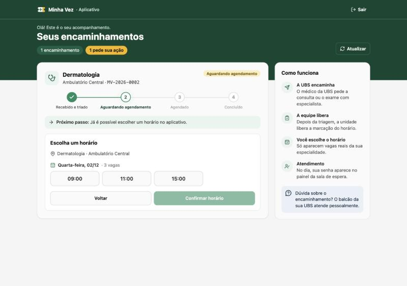
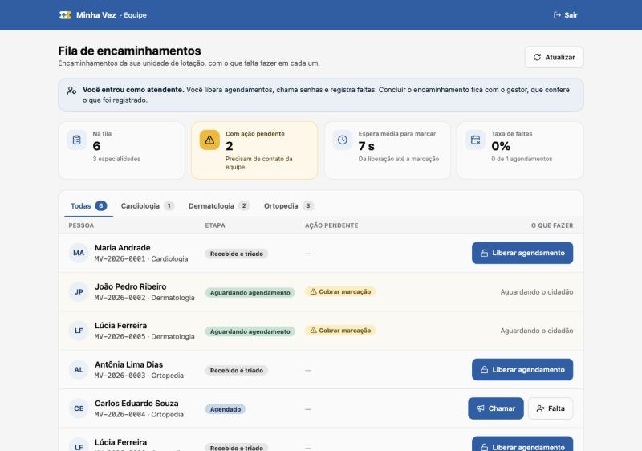
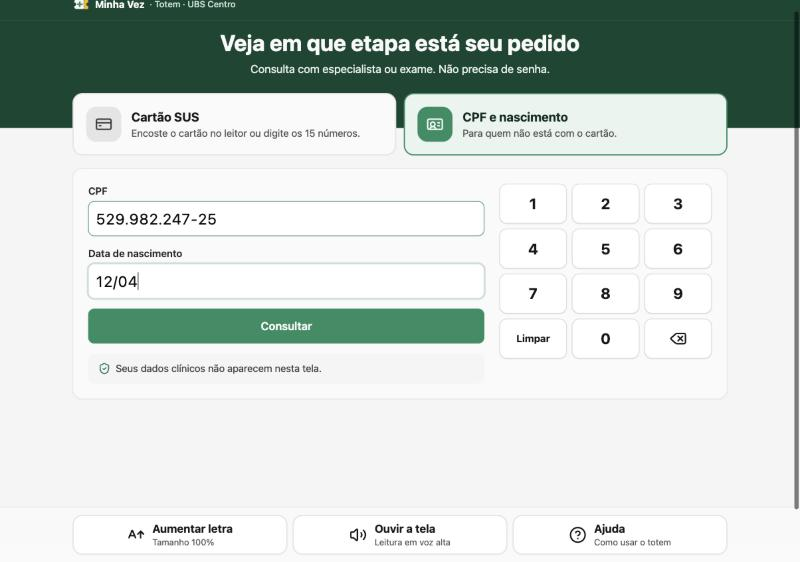
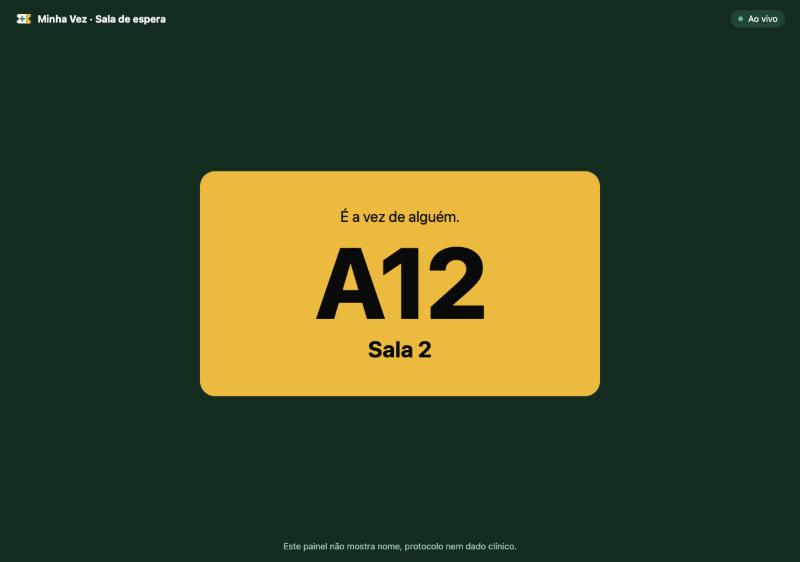
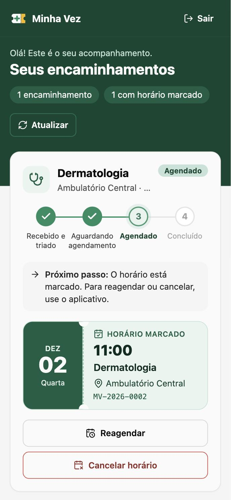
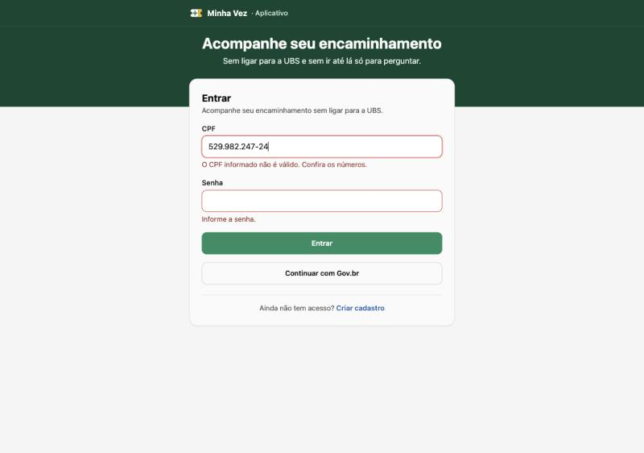
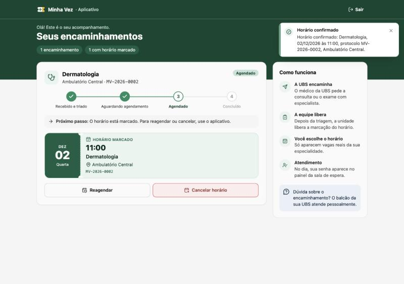
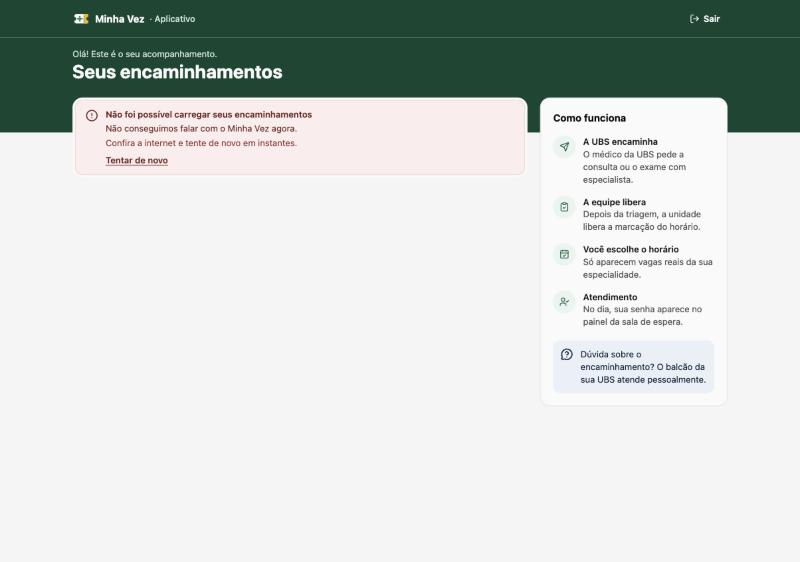
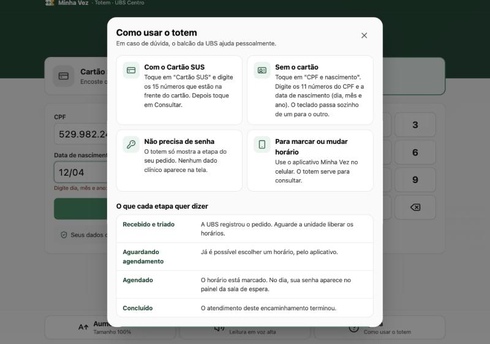

# Parte 3 — Protótipo funcional com React

O front-end do Minha Vez é uma aplicação React que consome a **API real** do backend Spring desenvolvido nas fases
anteriores. Não há endpoint simulado: todas as telas leem e gravam no servidor, que roda com **dados sintéticos**
criados a cada inicialização (nenhum é de paciente real). O código está em `src/frontend/`, e as instruções para
rodar estão no fim deste texto.

## 3.1 As telas

O protótipo cobre as cinco User Stories do backlog (US01 a US05), em quatro canais e uma página inicial.

| Rota | Canal | O que a pessoa faz | User Stories |
| --- | --- | --- | --- |
| `/` | Página inicial | Entende o problema e o produto, e acessa os quatro canais | — |
| `/acompanhar` | Aplicativo do cidadão | Entra (CPF e senha, cadastro ou Gov.br), vê a etapa do encaminhamento, escolhe, reagenda ou cancela horário | US01, US02, US03 |
| `/totem` | Totem da UBS | Consulta a etapa com Cartão SUS ou CPF e data de nascimento, sem senha | US01, US02 |
| `/painel` | Painel da sala de espera | Vê a senha chamada em tempo real, sem nome nem dado clínico | US04 |
| `/equipe` | Canal da equipe e do gestor | Vê a fila por especialidade e os indicadores; libera agendamento, chama senha, registra falta e conclui | US05 e ações da US02 e US04 |










## 3.2 Tecnologias e organização do código

React 18 com TypeScript, empacotado pelo Vite 5. Rotas com React Router 6, estilo com Tailwind CSS 4 e ícones da
biblioteca Lucide.

O código é separado em camadas. Cada camada só conhece a de baixo:

```
routes/        telas, uma pasta por canal (tracking, kiosk, panel, staff, landing)
   ↓ usam
components/ui  componentes visuais reutilizáveis
hooks/         estados de integração (useQuery, useAction) e formulário (useForm)
   ↓ chamam
api/           cliente HTTP e um módulo por canal; tipos que espelham o contrato
   ↓ HTTP
backend Spring (/api)
```

| Pasta | Conteúdo |
| --- | --- |
| `src/api/` | `client.ts` (a única função que faz `fetch`), `citizen.ts`, `staff.ts`, `panel.ts` e `types.ts` |
| `src/hooks/` | `useAsync.ts` (`useQuery` e `useAction`) e `useForm.ts` |
| `src/components/ui/` | `Button`, `TextField`, `Alert`, `ErrorAlert`, `Toast`, `Card`, `Badge`, `EmptyState`, `Skeleton`, `StatusTrail`, `AppointmentTicket`, `NumericKeypad`, `AppShell` |
| `src/lib/` | Validação (`validation.ts`), tradução de erros (`errors.ts`), formatação de datas e rótulos |
| `src/session/` | Guarda do token de sessão por canal |
| `src/routes/` | As telas de cada canal |

## 3.3 Requisitos do enunciado

### Interface responsiva

Todas as telas funcionam do celular (375 px de largura) à tela de computador. No computador, o aplicativo ganha
uma coluna lateral "Como funciona" e a fila da equipe vira uma tabela; no celular, as mesmas informações empilham.
A largura de cada tela foi conferida no navegador para não haver rolagem horizontal.



### Formulário com validação de dados

São seis formulários: entrar no aplicativo, criar cadastro, entrar pelo Gov.br, identificação no totem, login da
equipe e chamada de senha. A validação acontece em dois lugares:

- **No navegador** (`src/lib/validation.ts`), com as mesmas regras do backend: CPF e Cartão SUS conferidos pelo
  dígito verificador (rotina oficial do DATASUS para o cartão), data de nascimento que não pode estar no futuro,
  senha com pelo menos 8 caracteres e confirmação igual à senha. O erro aparece embaixo do campo assim que a pessoa
  sai dele ou tenta enviar, e some quando ela corrige.
- **No servidor**, que valida tudo de novo. Quando o erro só pode ser descoberto lá (por exemplo, CPF já
  cadastrado), ele também é mostrado embaixo do campo correspondente.

Os campos usam máscara (CPF `000.000.000-00`, Cartão SUS `000 0000 0000 0000`) e teclado numérico no celular.



### Consumo de APIs

O front consome a API real: 19 operações do backend, entre identificação, acompanhamento, agendamento, fila da
equipe e painel. O painel da sala de espera recebe as chamadas em tempo real por **Server-Sent Events**
(`/api/painel/eventos`) e, como segurança, confere o estado a cada 15 segundos.

Em desenvolvimento, o Vite repassa tudo o que começa com `/api` para o backend em `localhost:8080`, então o front
não guarda endereço de servidor no código.

**Estratégia de simulação.** O enunciado permite simular endpoints. O grupo não precisou, porque a API já estava
pronta. A única parte simulada é o **login pelo Gov.br**, e a simulação está no próprio backend: a rota
`/api/app/oauth` recebe o CPF que o Gov.br teria confirmado e responde com `oauthSimulado: true`. O front trata essa
rota como qualquer outra e avisa na tela que o Gov.br é ilustrativo.

### Tratamento explícito dos estados de integração

Toda chamada passa por um de dois hooks (`src/hooks/useAsync.ts`), que expõem sempre os mesmos estados: `idle`,
`loading`, `success` e `error`.

- `useQuery` faz as leituras feitas ao abrir uma tela (acompanhamento, horários, fila) e cancela a requisição
  anterior se a pessoa sair da tela.
- `useAction` faz as ações disparadas pela pessoa (entrar, confirmar horário, chamar senha).

Cada estado tem uma forma visual própria:

| Estado | O que a tela mostra |
| --- | --- |
| Carregando | Esqueleto cinza no formato do conteúdo; botões com indicador de carregamento e texto "Entrando…", "Confirmando…" |
| Sucesso | Notificação verde (toast) com a confirmação do servidor, e a tela recarrega os dados |
| Falha | Alerta vermelho com título, explicação e dica do que fazer; botão "Tentar de novo" só quando repetir pode resolver (rede, falha interna) |
| Vazio | Mensagem própria, com ícone, para quando não há dado (ex.: "Você não tem encaminhamento em andamento") — não é tratado como erro |
| Sessão vencida | Aviso amarelo "Sua sessão terminou" e volta para a tela de entrada |





### Componentes estilizados com estilo consistente

Todas as cores vêm dos tokens de design do projeto (`docs/design/tokens.json`), que um script converte em classes
do Tailwind. Nenhum componente usa cor solta. A cor tem significado:

- **Verde** é o canal do cidadão (aplicativo, totem);
- **Azul** é o canal da equipe e do gestor;
- **Amarelo** é a senha chamada no painel e o que pede atenção.

A marca é um ingresso de senha com a cruz da saúde, em verde, e o canhoto amarelo. Os ícones são da biblioteca
Lucide, a mesma em todas as telas. Animações curtas são desligadas quando o sistema operacional pede menos
movimento.

### Componentes reutilizáveis e cliente de API em módulo próprio

O cliente de API fica em `src/api/`, isolado das telas. Nenhuma tela chama `fetch` diretamente: todas usam as
funções de `citizenApi`, `staffApi` e `panelApi`. A função `request` em `client.ts` é o único ponto que:

- monta o endereço e o cabeçalho `Authorization: Bearer`;
- lê o corpo de erro do contrato e transforma qualquer falha em um `ApiError` com `codigo` e `mensagem`;
- distingue "o servidor recusou" de "o servidor nem respondeu" (sem conexão).

Os componentes de `components/ui` são usados por todos os canais. Exemplos: a mesma `StatusTrail` (trilha de
etapas) aparece no aplicativo, no totem e na página inicial; o mesmo `ReferralCard` mostra o encaminhamento no
aplicativo, com ações, e no totem, só para consulta. A página inicial monta suas ilustrações com esses mesmos
componentes e dados de exemplo, então ela acompanha qualquer mudança nas telas.

## 3.4 Como o contrato de integração foi considerado

O contrato da API está em `docs/fase-4/contrato-da-api.md` e foi seguido em três pontos:

1. **Estrutura de resposta.** `src/api/types.ts` descreve em TypeScript cada resposta do contrato. Campo que o
   servidor omite quando é nulo aparece como opcional, e o compilador obriga a tela a tratar a ausência.
2. **Erros previsíveis.** Todo erro do backend tem o formato `{ "codigo": "...", "mensagem": "..." }`.
   `src/lib/errors.ts` traduz cada código em título, explicação e dica para a pessoa:

| Código | HTTP | O que a pessoa vê |
| --- | --- | --- |
| `DADOS_INVALIDOS` | 400 | "Confira os dados", com a mensagem do servidor |
| `SENHA_INCORRETA` | 401 | "Dados de acesso não conferem" |
| `SESSAO_INVALIDA`, `SESSAO_AUSENTE` | 401 | "Sua sessão terminou" e volta para a entrada |
| `ACESSO_NEGADO` | 403 | "Ação não permitida neste canal" |
| `CIDADAO_NAO_ENCONTRADO` | 404 | "Cadastro não encontrado", com a dica de procurar o balcão |
| `CPF_JA_CADASTRADO` | 409 | Erro embaixo do campo CPF e dica de entrar com a senha |
| `REGRA_VIOLADA` | 409 | "Não foi possível concluir", com a regra explicada pelo servidor |
| `MUITAS_TENTATIVAS` | 429 | "Acesso bloqueado por alguns minutos" (ver Parte 4) |
| `FALHA_INTERNA` | 500 | "O sistema teve um problema. Nada foi alterado." |
| sem resposta | — | "Sem conexão com o servidor", com "Tentar de novo" |

3. **O servidor decide as regras.** O front não recalcula regra de negócio: campos como `podeAgendar` e
   `podeAlterarHorario`, e o perfil de quem entrou na equipe, definem quais botões aparecem. Se as duas pontas
   discordarem, vale o servidor, que valida de novo.

## 3.5 Acessibilidade

O totem atende quem tem baixa visão, quem lê com dificuldade e quem nunca usou um. Por isso ele tem uma barra fixa
com três botões grandes:

- **Aumentar letra:** alterna a tela inteira entre 100%, 120% e 140%;
- **Ouvir a tela:** lê em voz alta, em português, o que está na tela, usando a síntese de voz do próprio aparelho
  (nada é enviado para fora);
- **Ajuda:** explica, passo a passo, como se identificar e o que significa cada etapa.

Também tem teclado numérico na tela (totem não tem teclado físico). Ao encerrar, tudo volta ao padrão para a próxima
pessoa.



Nas demais telas: botões com no mínimo 44 px de altura, foco visível pelo teclado, rótulos e mensagens ligados aos
campos para leitores de tela, avisos anunciados (`aria-live`) e contraste a partir dos tokens.

## 3.6 Como foi verificado

O protótipo foi testado no navegador, com o backend rodando, em todos os fluxos: entrar, criar cadastro, Gov.br,
escolher, reagendar e cancelar horário, liberar agendamento, chamar senha com o painel atualizando ao vivo,
registrar falta com confirmação, concluir encaminhamento, identificar-se no totem por Cartão SUS e por CPF, sessão
vencida e servidor fora do ar. A largura das telas foi conferida em 375 px e em 1280 px. O build de produção
(`npm run build`) compila sem erros de tipo.

## 3.7 Limites conhecidos

- **Dados em memória.** O backend guarda tudo em memória; reiniciar volta aos dados sintéticos iniciais.
- **Remarcação depois de falta.** Depois que a equipe registra a falta, nem o cidadão nem a equipe conseguem marcar
  outro horário: o backend recusa. O front não oferece essa ação para não prometer o que o servidor nega.
- **Conclusão do encaminhamento.** O gestor conclui o encaminhamento sem o sistema conferir se a consulta já
  aconteceu nem se a pessoa faltou. Depois de concluído, o horário continua marcado, então o cidadão ainda vê o
  bilhete e a senha chamada pode continuar no painel.
- **Urgência.** O backend guarda se o encaminhamento é urgente, mas a API da fila não envia esse dado, então a tela
  não o mostra.
- **Gov.br ilustrativo**, como descrito em 3.3.

## Como rodar

```bash
cd src/backend && mvn spring-boot:run
```

```bash
cd src/frontend && npm install && npm run dev
```

Abrir `http://localhost:5173`. Os logins de demonstração (todos com senha `minhavez`) estão na página inicial, na
seção "Demonstração", e em `src/README.md`.
