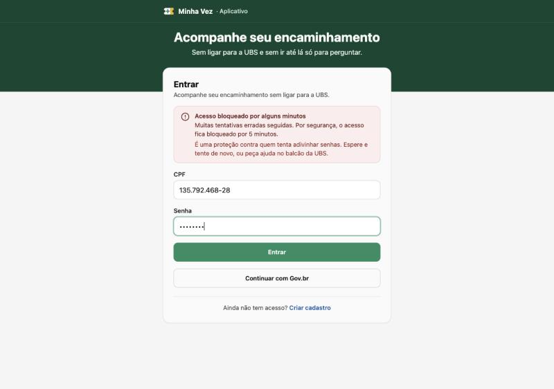
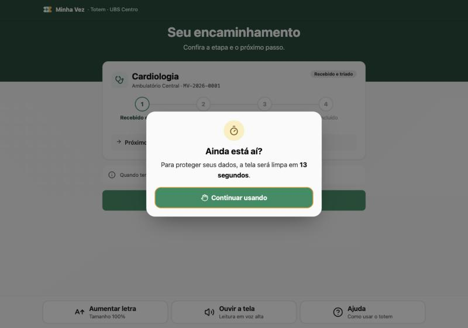
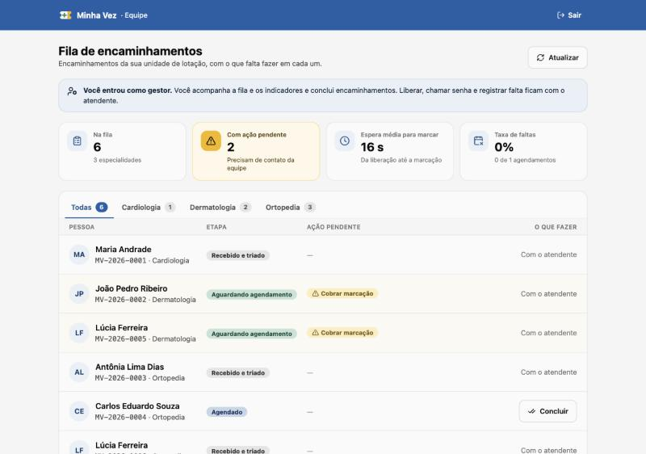
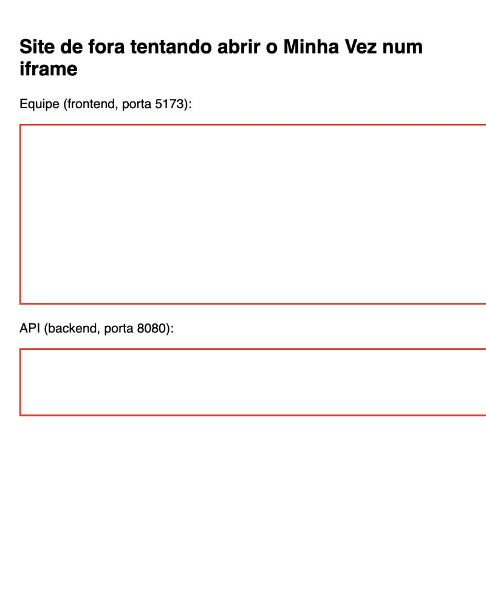

# Parte 4 — Segurança da informação

O Minha Vez lida com dados de saúde, que a LGPD (Lei 13.709/2018) classifica como **dado pessoal sensível**, e é
usado por um público amplo, em canais que vão do celular da pessoa a um totem compartilhado na UBS. Por isso a
segurança foi pensada em cada canal, e não só no login.

O enunciado pede ao menos três práticas. O sistema aplica nove, todas implementadas no código e verificadas por
testes automatizados ou no navegador. A tabela resume; as seções seguintes justificam cada uma.

| # | Prática | Onde está | Protege contra |
| --- | --- | --- | --- |
| 1 | Senha guardada como hash com sal | `identificacao/SenhaHash.java` | Vazamento do banco revelar senhas |
| 2 | Login que não revela quem tem cadastro | `identificacao/ServicoDeIdentificacao.java` | Descobrir CPFs cadastrados |
| 3 | Limite de tentativas de entrada | `identificacao/LimiteDeTentativas.java` | Chute de senha (força bruta) |
| 4 | Sessão com token aleatório, validade e saída | `memoria/AcervoMinhaVez.java`, `kiosk/IdleGuard.tsx` | Sessão roubada ou esquecida aberta |
| 5 | Controle de acesso por canal e por unidade | serviços de cada canal | Usar a função de outro canal ou ver dado alheio |
| 6 | Segregação de funções por perfil | `equipe/RegrasDePerfil.java` | Uma pessoa só executar e encerrar o próprio registro |
| 7 | Validação de entradas | `lib/validation.ts`, `Cpf.java`, `CartaoSus.java` | Dado inválido, injeção |
| 8 | Minimização de dados pessoais | respostas da API e telas | Exposição de dado pessoal e de saúde |
| 9 | Proteção contra clickjacking | `config/ProtecaoContraIframe.java`, `vite.config.ts` | Abrir o sistema escondido dentro de outro site |

Os caminhos do backend são relativos a `src/backend/src/main/java/com/hackgov/backend/`, e os do front, a
`src/frontend/src/`.

## 1. Senha guardada como hash com sal

**O que é.** A senha nunca é guardada como texto. O sistema guarda o resultado do algoritmo **PBKDF2 com
HMAC-SHA256**, com **65.536 iterações** e um **sal aleatório de 16 bytes** diferente para cada pessoa. Para conferir
uma senha, o sistema calcula o hash de novo e compara em tempo constante (`MessageDigest.isEqual`).

**Por que.** Se o banco vazar, as senhas não aparecem. O sal impede que duas pessoas com a mesma senha tenham o
mesmo hash e inutiliza tabelas prontas de senhas comuns. As muitas iterações tornam cada tentativa de adivinhar
cara para quem ataca. A comparação em tempo constante evita que o tempo de resposta revele quanto da senha estava
certo. Muitas pessoas repetem a mesma senha em vários serviços, então proteger a senha protege também a vida
digital do cidadão fora do Minha Vez.

**Como foi verificado.** Testes de cadastro e login (`IdentificacaoHttpTest`); a senha exige no mínimo 8 caracteres
no front e no back.

## 2. Login que não revela quem tem cadastro

**O que é.** Senha errada e CPF sem cadastro recebem **exatamente a mesma resposta**: `401` com "CPF ou senha não
conferem". O mesmo vale para o login da equipe e para o protocolo de outra pessoa, que responde `404` como se não
existisse.

**Por que.** Se a resposta fosse diferente, qualquer um poderia testar CPFs e descobrir quem é paciente da UBS, o que
já é uma informação de saúde.

**Como foi verificado.** Testado contra a API: senha errada e CPF inexistente devolvem o mesmo código e a mesma
mensagem; um teste automático confirma que CPF sem cadastro também conta para o bloqueio, sem revelar nada.

## 3. Limite de tentativas de entrada

**O que é.** Depois de **5 erros seguidos** na mesma conta, o acesso fica **bloqueado por 5 minutos**, mesmo com a
senha certa. A resposta é `429 MUITAS_TENTATIVAS`, e a tela explica que é uma proteção. Um acerto zera a contagem.
Vale para o aplicativo (por CPF), para a equipe (por login) e para o totem (por documento).

**Por que.** Sem limite, um programa pode testar milhares de senhas. No totem o risco é maior: ele identifica por
CPF e data de nascimento, e a data não é segredo. O bloqueio torna o chute inviável.

**Como foi verificado.** Cinco testes em `SegurancaHttpTest`: bloqueio após 5 erros, liberação depois de 5 minutos,
acerto zerando a contagem, login da equipe e chute de datas no totem. No navegador, a sexta tentativa mostra a
mensagem de bloqueio.

## 4. Sessão com token aleatório, validade e saída

**O que é.**

- Cada login gera um **token de 32 bytes aleatórios** (`SecureRandom`), impossível de adivinhar.
- O token **vence depois de um tempo sem uso**: 30 minutos no aplicativo e no canal da equipe, **3 minutos no
  totem**. Cada uso renova o prazo.
- **Sair** invalida o token no servidor, no aplicativo e na equipe (`DELETE /api/equipe/sessao`).
- No **totem**, se a pessoa for embora sem encerrar, depois de 1 minuto parado aparece "Ainda está aí?" com contagem
  de 15 segundos; se ninguém tocar, a tela é limpa.
- No navegador, o token do aplicativo e da equipe fica no `sessionStorage`, que some quando a aba fecha. No totem
  ele fica só na memória da tela.

**Por que.** Um token que vale para sempre transforma qualquer vazamento em acesso permanente. No totem, que é
compartilhado, o risco real é a próxima pessoa da fila ver os dados de quem saiu sem encerrar.

**Como foi verificado.** Quatro testes em `SegurancaHttpTest` simulam a passagem do tempo com um relógio controlado:
expiração no aplicativo, renovação pelo uso, expiração no totem e na equipe. Outro teste confirma que o token da
equipe deixa de valer depois de sair. No navegador, o totem limpou a tela sozinho após o aviso.

## 5. Controle de acesso por canal e por unidade

**O que é.** Cidadão, totem e equipe recebem tokens de canais diferentes, e cada rota aceita só o canal certo.

- O token do cidadão não abre a fila da equipe: `403`.
- O totem só consulta; tentar marcar horário com ele responde `403` ("O totem só acompanha a etapa").
- O cidadão só acessa os próprios encaminhamentos; o protocolo de outra pessoa responde `404`.
- A equipe só vê e altera encaminhamentos da própria unidade de lotação.

**Por que.** É o princípio do menor privilégio: cada um acessa só o que precisa para a sua tarefa. Um totem
comprometido, por exemplo, não consegue alterar nada.

**Como foi verificado.** Testes em `AgendamentoHttpTest`, `AcompanhamentoHttpTest`, `FilaHttpTest`,
`PainelHttpTest` e `SegurancaHttpTest` (equipe de outra UBS não chama senha), e chamadas feitas direto à API.
Durante a revisão deste texto, a conferência de unidade faltava na chamada de senha; foi corrigida e ganhou teste.

## 6. Segregação de funções por perfil

**O que é.** O canal da equipe tem dois perfis, com funções separadas:

- **Atendente:** libera o agendamento, chama a senha e registra a falta.
- **Gestor:** acompanha a fila e os indicadores e é quem **conclui** o encaminhamento.

A tela mostra só os botões do perfil, e o servidor recusa com `403` a ação do perfil errado.

**Por que.** Quem executa não encerra: o encaminhamento só é dado como concluído por alguém que não foi quem
registrou os passos. Isso reduz erro e fraude (por exemplo, concluir um atendimento que não aconteceu) e deixa
claro quem é responsável por cada etapa.

**Como foi verificado.** Três testes em `SegurancaHttpTest` (perfil no login e na fila, atendente não conclui, gestor
não opera a fila) e no navegador com os dois logins.

## 7. Validação de entradas

**O que é.** Toda entrada é validada **no navegador e de novo no servidor**. CPF e Cartão SUS são conferidos pelo
dígito verificador; datas não podem estar no futuro; campos obrigatórios são exigidos; corpo de requisição ilegível
é recusado com `400`, sem derrubar nada.

**Por que.** A validação no navegador dá retorno rápido à pessoa; a do servidor é a que protege, porque qualquer
um pode chamar a API sem passar pela tela.

**Injeção de SQL e de script.**

- **SQL:** hoje o backend não executa nenhuma consulta SQL (os dados ficam em memória), então não há onde injetar.
  Quando o banco do modelo físico for ligado, o acesso será feito pelo JPA, que envia consultas com parâmetros e
  nunca monta SQL juntando texto.
- **Script (XSS):** o React escapa todo texto exibido, e o front não usa `innerHTML`, `dangerouslySetInnerHTML` nem
  `eval` (conferido no código).

## 8. Minimização de dados pessoais

**O que é.** Cada tela recebe só o que precisa, seguindo o princípio da necessidade da LGPD (art. 6º):

- o **painel** da sala de espera mostra só senha e sala: nenhum nome, protocolo ou especialidade;
- a **fila da equipe** não envia CPF;
- nenhuma tela mostra dado clínico (laudo, CID, diagnóstico); o cidadão vê etapa, horário e unidade;
- erros inesperados respondem só uma mensagem genérica ("Não foi possível concluir agora. Tente de novo ou peça
  ajuda no balcão."), sem detalhes técnicos, que ficam apenas no registro do servidor.

**Por que.** Dado que não sai do servidor não vaza. O painel fica numa sala pública, e o nome de quem está na fila de
uma especialidade já revela algo sobre a saúde dessa pessoa.

## 9. Proteção contra clickjacking

**O que é.** Toda resposta do backend e do front traz `X-Frame-Options: DENY` e
`Content-Security-Policy: frame-ancestors 'none'`, que proíbem abrir o sistema dentro de um iframe. Como reserva,
para servidores que não mandem esses cabeçalhos, o `index.html` tem um script que esconde a página se ela estiver
dentro de um iframe.

**Por que.** Sem isso, um site malicioso pode carregar o Minha Vez invisível por cima de um botão próprio e fazer a
pessoa, sem saber, clicar em "Cancelar horário" ou "Registrar falta".

**Como foi verificado.** Um teste automático confere os cabeçalhos (inclusive em respostas de erro). No navegador,
uma página em outra origem tentou abrir o front e a API em iframes, e o navegador bloqueou os dois.

## Riscos conhecidos e próximos passos

| Risco | Situação | Possível solução |
| --- | --- | --- |
| Tráfego sem HTTPS | Aceitável no protótipo local | Publicar só com HTTPS, para que senha e token não trafeguem abertos |
| Console do banco H2 ativo | Aberto em `/h2-console` no ambiente de desenvolvimento | Desligar antes de publicar |
| Bloqueio usado para atrapalhar alguém | Quem souber o CPF de outra pessoa pode bloquear a conta dela por 5 minutos | Bloqueio por endereço de origem, além da conta |
| Mensagem "Esta conta entra pelo Gov.br" | Revela que aquele CPF tem cadastro | Unificar com a resposta de senha errada |
| Acesso pelo Gov.br simulado | A rota `/api/app/oauth` aceita qualquer CPF já cadastrado sem senha; aceitável só no protótipo local, com dados sintéticos | Integrar o login real do Gov.br, em que o próprio Gov.br confirma a identidade antes de o sistema abrir a sessão |
| Token acessível a script no navegador | Mitigado pelo escape do React e pela validade curta | Política de conteúdo (CSP) completa no servidor de produção |
| Registro de auditoria incompleto | Mudança de etapa e chamada de senha guardam quem fez; o registro de falta ainda não | Registro de auditoria de todas as ações da equipe, base para a Parte 5 |

## Resumo dos testes

Os testes do backend rodam com `mvn test` em `src/backend`. São 58 no total, todos passando; 15 deles, em
`src/backend/src/test/java/com/hackgov/backend/seguranca/SegurancaHttpTest.java`, cobrem especificamente as práticas
3, 4, 5, 6 e 9.
